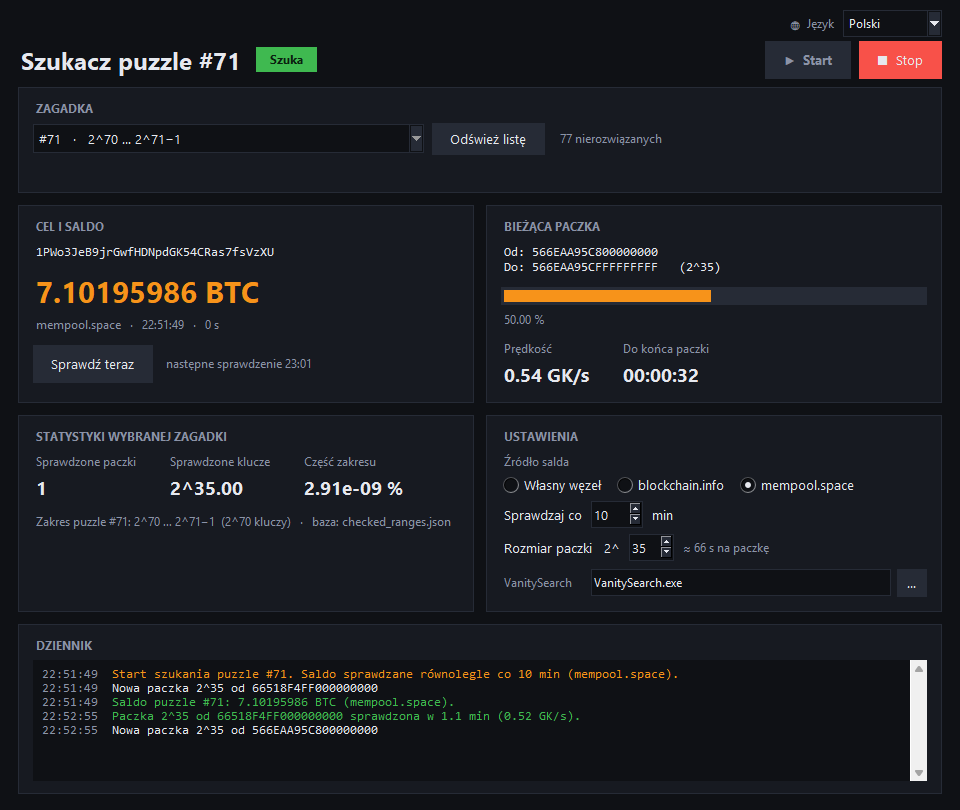
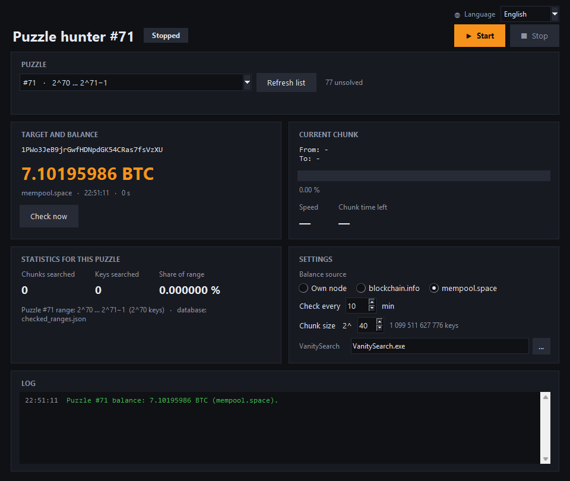
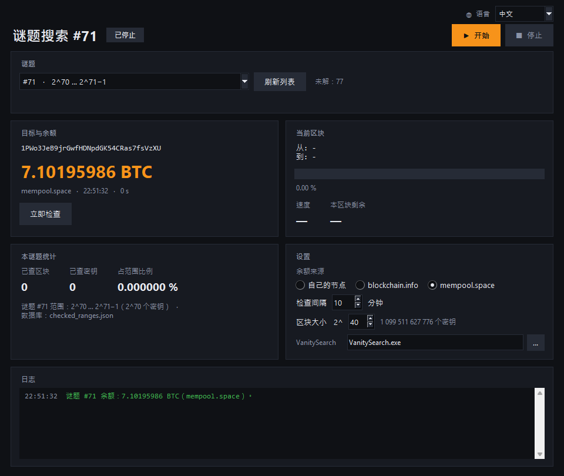
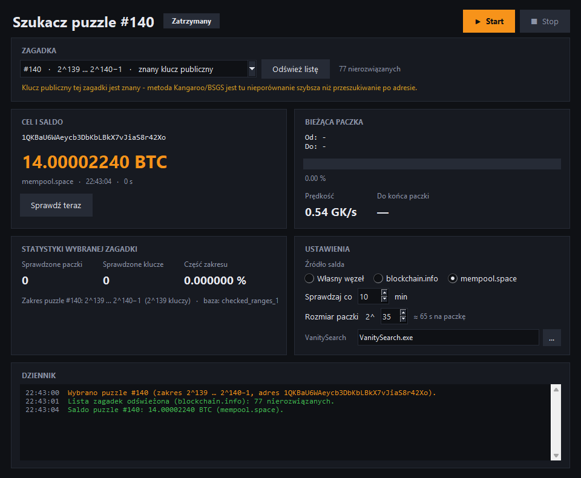

# Szukacz puzzle: okno do VanitySearch

**[Polski](#polski)** · **[English](#english)**



---

## Polski

Okienkowa nakładka na VanitySearch do szukania kluczy w [Bitcoin puzzle](https://privatekeys.pw/puzzles/bitcoin-puzzle-tx).
Wybierasz zagadkę i klikasz Start. Program losuje paczki kluczy w jej zakresie, przepuszcza je przez kartę graficzną
i zapamiętuje, co już sprawdził. W tym samym czasie pilnuje, czy nikt nie zabrał nagrody.

### Kilka słów ode mnie

Cześć! Ten program powstaje po godzinach, na zwykłym domowym komputerze. Nie mam farmy koparek ani serwerowni,
tylko jedną kartę graficzną i kredyt, który co miesiąc trzeba spłacić. Zagadki Bitcoina to dla mnie nauka
i frajda, a narzędziem, które sobie do nich zrobiłem, dzielę się za darmo. Kod jest otwarty: możesz go używać,
zmieniać i sprawdzić, że nie robi nic za Twoimi plecami.

Jeśli okno Ci się przydało, a masz ochotę i możliwość, każda drobna wpłata pomoże mi dołożyć do lepszego
sprzętu i znaleźć więcej czasu na dalszy rozwój. Jeśli nie, to też w porządku: zostaw gwiazdkę na GitHubie,
to naprawdę motywuje. 🙂

Proszę tylko o jedno: **nie wpłacaj pieniędzy, których potrzebujesz.** Szansa na znalezienie klucza jest
bardzo mała. To hobby, a nie inwestycja.


```
bc1q73ehm20v8y0zlfc5qh9mqzzftmczp3yg0f6med
```

### Co potrafi

- **10 języków**, przełączanych w prawym górnym rogu okna: polski, English, Deutsch, Español, Français,
  Italiano, Português, Русский, Українська, 中文.
- **Każda nierozwiązana zagadka do wyboru (71–160).** Adresy pochodzą prosto z oryginalnej transakcji
  `08389f34…cd15` z 2015 roku (wyjście nr N to zagadka nr N), więc nie ma w nich literówek.
  Klucz zagadki nr N leży w zakresie **2^(N-1) … 2^N − 1** i tylko tam program szuka.
  Przycisk „Odśwież listę” sprawdza wszystkie 160 adresów i usuwa z listy zagadki, które ktoś już rozwiązał.
- **Własny zakres i własne adresy.** Przełącz na „Własny zakres i adresy”, wpisz początek i koniec zakresu (hex)
  i wklej adresy (1… albo bc1q…) albo wczytaj je z pliku `.txt`. Nieprawidłowe adresy program pomija, przy wielu
  adresach używa listy VanitySearch (`-i`). Zakres nie musi być potęgą dwójki. Każda kombinacja zakresu i adresów
  ma własną bazę `checked_custom_….json`.
- **Gdzie są adresy zagadek:** w pliku [`puzzle_list.py`](puzzle_list.py) (słownik `ADDRESSES`), wygenerowanym
  z oryginalnej transakcji. Twoje własne adresy zapisują się w ustawieniach `szukacz_gui.json`.
- **Losowe paczki od 2^32 do 2^46 kluczy.** Rozmiar zmieniasz w trakcie pracy. Paczka jest zawsze wyrównana
  do swojego rozmiaru, a paczki różnej wielkości nigdy nie nachodzą na już sprawdzone fragmenty.
- **Osobna baza dla każdej zagadki** (`checked_ranges_N.json`, dla #71 `checked_ranges.json`). Zapis jest atomowy.
  Paczka trafia do bazy tylko wtedy, gdy VanitySearch zakończy się poprawnie.
- **Saldo sprawdzane równolegle**, bez zatrzymywania karty. Źródło do wyboru: własny węzeł Bitcoin Core
  (`scantxoutset`, działa też w trybie prune), blockchain.info albo mempool.space. Gdy adres jest pusty albo
  jego środki są właśnie wydawane w mempoolu, szukanie zatrzymuje się samo.
- **Na żywo:** prędkość, postęp paczki, czas do końca, liczba sprawdzonych kluczy i jaka to część zakresu.
- **Bezpieczeństwo:** znaleziony klucz trafia wyłącznie do `znalezione.txt`, nigdy do dziennika w oknie.

| English | 中文 |
|---|---|
|  |  |

Przy zagadkach o numerach podzielnych przez 5 klucz publiczny jest znany. Okno przypomina wtedy,
że metody Kangaroo/BSGS są tam nieporównanie szybsze niż szukanie po adresie:



### Instalacja (Windows)

Potrzebny jest Python 3 z tkinter (instalator z python.org ma go w zestawie). Dodatkowe pakiety nie są potrzebne.

1. **VanitySearch.exe:** pobierz gotowy plik dla swojej karty z zakładki [Releases](https://github.com/enterzbigi-hue/VanitySearch-Blackwell/releases)
   i zapisz go w tym folderze jako `VanitySearch.exe`:

   | Karta | Plik |
   |---|---|
   | RTX 30xx (Ampere) | `vanitysearch-sm86.exe` |
   | RTX 40xx (Ada) | `vanitysearch-sm89.exe` |
   | RTX 50xx (Blackwell) | `vanitysearch-sm120.exe` |

   Możesz go też zbudować sam z katalogu głównego repozytorium (Visual Studio 2022 Build Tools i CUDA ≥ 12.8):
   ```
   python bench/build.py opt --arch 89
   ```
2. **Sprawdź, czy program znajduje klucze.** Ten test ukrywa losowy klucz w małym zakresie i sprawdza,
   czy VanitySearch go znajdzie:
   ```
   python bench/bench.py selftest gui/VanitySearch.exe --bits 36 --n 3
   ```
3. **Uruchom okno:** dwuklik na `szukacz_puzzle_gui.pyw`. Wersja `pythonw szukacz_puzzle_gui.pyw --start`
   od razu zaczyna szukać, co przydaje się przy autostarcie.

`szukacz_puzzle.py` to prostsza wersja konsolowa (tylko #71, paczki 2^42) i jednocześnie moduł, z którego korzysta okno.

### Uczciwie o szansach

Zakres #71 to 2^70 ≈ 1,2·10²¹ kluczy. Karta sprawdzająca 1,2 mld kluczy na sekundę przejrzałaby go
w około 31 000 lat. Każda paczka 2^42 daje szansę 1 na 268 mln. To loteria, a nie sposób na zarobek.

### Gdyby się udało

Kiedy wyślesz transakcję z adresu zagadki, jej klucz publiczny trafi do mempoola. Przy małym zakresie boty
policzą z niego klucz prywatny w kilka minut i podmienią Twoją transakcję na swoją (RBF).
**Nie wysyłaj nagrody zwykłym portfelem.** Użyj usługi, która przekazuje transakcję prywatnie, bezpośrednio
do górnika, z pominięciem publicznego mempoola.

---

## English

A GUI for VanitySearch for the [Bitcoin puzzle](https://privatekeys.pw/puzzles/bitcoin-puzzle-tx).
Pick a puzzle and press Start. The program searches random chunks of keys inside that puzzle's range on your GPU,
remembers what it has already searched, and keeps watching whether the prize is still there.

### A few words from me

Hi! I build this in my spare time on an ordinary home PC. I have no mining farm and no server room, just one
graphics card and a loan I pay off every month. The Bitcoin puzzle is how I learn and have fun, and I share the
tool I made for it for free. The code is open: use it, change it, and check that it does nothing behind your back.

If the GUI is useful to you and you'd like to and can afford it, any small donation helps me put money toward
better hardware and find more time to keep working on it. If not, that's fine too: a star on GitHub
really keeps me going. 🙂

Just one request: **please don't donate money you need.** The chance of finding a key is tiny.
This is a hobby, not an investment.

BTC: `bc1q73ehm20v8y0zlfc5qh9mqzzftmczp3yg0f6med` (QR code above)

### Features

- **10 languages**, switchable in the top-right corner of the window.
- **Any unsolved puzzle 71–160.** Addresses come straight from the original 2015 puzzle transaction.
  Puzzle N is searched only inside **2^(N-1) … 2^N − 1**. "Refresh list" checks all 160 addresses and
  hides solved puzzles.
- **Own range and addresses:** enter any start/end (hex) and paste addresses (1… or bc1q…) or load them from a
  `.txt` file. Invalid ones are skipped, several addresses use VanitySearch's `-i` list. Built-in puzzle addresses
  live in [`puzzle_list.py`](puzzle_list.py).
- **Random aligned chunks of 2^32–2^46 keys**, resizable while running, with a per-puzzle database of searched
  chunks, so mixed sizes never overlap.
- **Parallel prize check** through your own Bitcoin Core node (`scantxoutset`, works with prune),
  blockchain.info or mempool.space. It stops by itself once the prize is gone or is being spent.
- **Safety:** a found key goes only to `znalezione.txt`, never to the on-screen log.

### Install (Windows)

Python 3 with tkinter is all you need. Download the `vanitysearch-smXX.exe` for your GPU from
[Releases](https://github.com/enterzbigi-hue/VanitySearch-Blackwell/releases) (sm86 = RTX 30, sm89 = RTX 40, sm120 = RTX 50), save it next to the scripts as
`VanitySearch.exe`, run the self-test from step 2 above, then double-click `szukacz_puzzle_gui.pyw`.

### Honest odds and a warning

Puzzle #71 is 2^70 keys, about 31,000 years for a GPU doing 1.2 billion keys per second. If you ever find a key,
**don't sweep it with a normal wallet**: the public key becomes visible in the mempool, and bots can recompute
the private key and replace your transaction. Send the transaction privately, directly to a miner.

---

GPU optimisations are the work of [StarWWW](https://github.com/StarWWW/VanitySearch-Blackwell),
[FixedPaul](https://github.com/FixedPaul/VanitySearch-Bitcrack) and [Jean-Luc Pons](https://github.com/JeanLucPons/VanitySearch).
